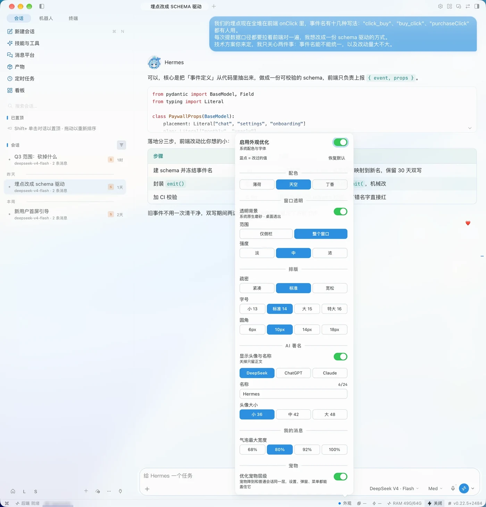
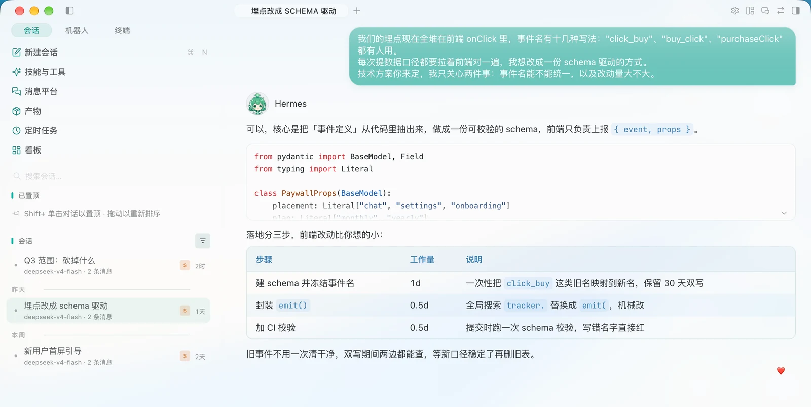
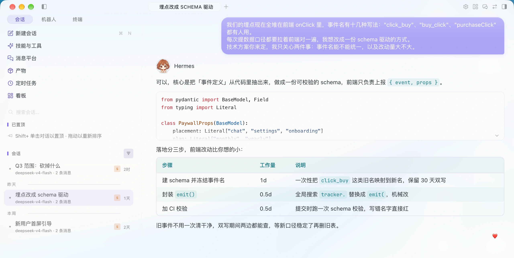

# 外观工坊（ui-studio）

> [!WARNING]
> **插件完全由 AI 生成，不保证可用性。**
> 代码是边用边改出来的，没有完整回归测试；应用升级改了结构，某些板块可能失效。装之前先备份你原来的 `plugin.js`。

Hermes 桌面应用的外观插件：配色、字号/疏密/圆角、气泡宽度、头像与动画、窗口透明、宠物层级，全部收在「设置 › 外观」一个面板里。

**目录**：[截图](#截图) · [安装](#安装) · [使用](#使用) · [设置项](#设置项) · [覆盖范围](#覆盖范围) · [命令](#命令面板) · [兼容性](#兼容性)

## 截图

整窗 + 外观面板（天空配色，开着窗口透明）：



同一段对话只换配色，其他不动：

| 薄荷 | 丁香 |
|:---:|:---:|
|  |  |

> 截图里的会话是示例数据，不是真实聊天记录。

## 安装

**一行命令（推荐）**

```bash
mkdir -p ~/.hermes/desktop-plugins/ui-studio && curl -fsSL \
  https://raw.githubusercontent.com/juzvior/ui-studio/main/plugin.js \
  -o ~/.hermes/desktop-plugins/ui-studio/plugin.js
```

装完在应用里按 `⌘K` → **Reload desktop plugins**（或重启应用）。

**手动方式**：建目录 `~/.hermes/desktop-plugins/ui-studio/`，把 `plugin.js` 放进去，再 `⌘K` → **Reload desktop plugins**。

**应用内安装**：Capabilities → Plugins → 用 Git 地址 `https://github.com/juzvior/ui-studio` 安装（会先探测仓库、锁定 commit，再复制到 `~/.hermes/desktop-plugins/`）。

> 注意：`hermes plugins install <url>` 只处理「智能体插件」（需要 `plugin.yaml`），装不了只有桌面半身的插件，别用那条。

**升级**就是把新的 `plugin.js` 覆盖进去再 Reload；插件本身不含任何自更新代码。

## 使用

应用内打开 **设置 › 外观**：所有改动即时生效、自动保存；底部可一键恢复默认，或关掉总开关回到应用原样。

三个入口都能到同一个面板：

| 入口 | 说明 |
|---|---|
| 状态栏「外观」 | 开启后才有，点开是窄版浮层 |
| `⌘K` 搜「外观」 | 打开、切换配色、调疏密、恢复默认都在这里 |
| 设置 › 外观 | 整页宽版；关掉总开关后也从这里底部重新打开 |

被改过档位的项左侧有一个蓝点；`恢复默认` 一次清空所有调整。

## 设置项

### 启用外观优化

总开关。关掉 = 立刻回到 Hermes 原样（样式是运行时注入的，卸载即干净），存档保留，再打开恢复上次的档位。

### 配色

| 选项 | 气泡色 | 说明 |
|---|---|---|
| 薄荷 | `#2FB3A6` | 默认 |
| 天空 | `#3E9FE0` | |
| 丁香 | `#9186F2` | |

一套配色同时管正文强调色和气泡色，并按配色注册应用主题（`apple` / `apple-mint` / `apple-sky` / `apple-lavender`），窗口外壳跟着一起变。

### 窗口透明

| 项 | 档位 | 默认 |
|---|---|---|
| 透明背景 | 开 / 关 | 关 |
| 范围 | 仅侧栏 / 整个窗口 | 仅侧栏 |
| 强度 | 淡 25 / 中 45 / 浓 65 | 32 |

写的是应用自带的同名设置（`hermes.desktop.translucency.v2`），不是自造的半透明遮罩——窗口拖动、毛玻璃层叠、失焦表现都和系统一致。机器不支持系统材质时这一组自动显示为跳过。

### 排版

| 项 | 档位 | 默认 | 影响 |
|---|---|---|---|
| 疏密 | 紧凑 / 标准 / 宽松 | 标准 | 段落间距、回复块间距、工具行间距、缩进，5 个间距变量一起缩放 |
| 字号 | 小 13 / 标准 14 / 大 15 / 特大 16 | 标准 14 | 正文、工具行、注释同比例，行高跟着走 |
| 圆角 | 6px / 10px / 14px / 18px | 10px | 按卡片圆角算系数，气泡、菜单、弹窗按比例一起变 |

### AI 署名

| 项 | 档位 | 默认 |
|---|---|---|
| 显示头像与名称 | 开 / 关 | 开（关掉只留正文） |
| 头像 | DeepSeek / ChatGPT / Claude | DeepSeek |
| 名称 | 任意文本，最多 24 字 | `Hermes` |
| 头像大小 | 36 / 42 / 48 px | 36 |

三套头像是 4 列 × 3 行的雪碧图，三个状态各自独立成动画（下面按 1:1 原始分辨率 96px 显示，放大看就是虚的，不要拉大）：

| | 待机 5.2s 一轮 | 工作中 0.8s 一轮 | 点击 0.9s 播一次 |
|:---|:---:|:---:|:---:|
| DeepSeek |  |  |  |
| ChatGPT |  |  |  |
| Claude |  |  |  |

- **待机**：5.2 秒一轮，中途眨一次眼（四帧，约 338ms）
- **工作中**：0.8 秒一轮循环；跟的是真实的 `message.status === 'running'`，长时间思考、跑工具时一直在动
- **点击**：0.9 秒播一次，停在末帧不回弹

头像大小（36 / 42 / 48px）靠 CSS 缩放雪碧图，不改像素。头像素材由 AI 生成，随插件一起提供。

### 我的消息

| 项 | 档位 | 默认 |
|---|---|---|
| 气泡最大宽度 | 68% / 80% / 92% / 100% | 80% |

你发的消息最宽能占消息栏多少比例；短消息仍然各自贴合内容，不会被拉成整行。

### 宠物

| 项 | 说明 |
|---|---|
| 优化宠物层级 | 宠物层级降到和普通会话一样，设置页、弹窗、菜单、弹层都能正常盖住它，不再浮在所有东西上面 |

## 覆盖范围

除了上面这些开关，样式本身覆盖这些区块（都按应用现有的 `data-slot` 结构与设计变量写，不改源码）：

- 字号与圆角 token、阴影层级
- 侧栏、菜单、输入区弹层的毛玻璃与分隔线
- 按钮、输入框、发送键的常态/悬停/按下
- 气泡形状、底色、圆角与最大宽度
- 工具调用行、代码块、表格、引用块
- 滚动条、弹窗、下拉菜单
- 标签条、搜索框、分组标题等碎细节
- 侧栏档案条
- 助手消息（头像泊位、名称排版）
- 强调色向终端、徽标等其他板块的延伸

## 命令面板

`⌘K` 里搜「外观」：

| 命令 | 作用 |
|---|---|
| 外观: 打开外观优化 | 打开面板 |
| 外观: 关掉，恢复 Hermes 原样 | 关总开关 |
| 外观: 切换配色方案（薄荷 → 天空 → 丁香） | 循环换配色 |
| 外观: 疏密「标准」/「紧凑」/「宽松」 | 三档疏密 |
| 外观: 恢复全部默认 | 清空所有调整 |

## 兼容性

样式是按 Hermes 桌面应用当前的 `data-slot` 结构与设计变量写的。应用大版本升级若改动这些结构，个别板块可能失效；总开关关掉即可完全还原，不会残留。

## 目录

```
ui-studio/
├── plugin.js                     # 插件本体（面板 + 样式注入 + 主题注册）
├── assets/
│   ├── avatar-<name>-<state>.gif # 三套头像 × 三态（idle / work / click）
│   └── screens/                  # 界面截图（WebP，2560 宽）
├── README.md
└── LICENSE                       # MIT
```

## 许可

MIT（见 `LICENSE`）。随意使用、修改、再分发。
